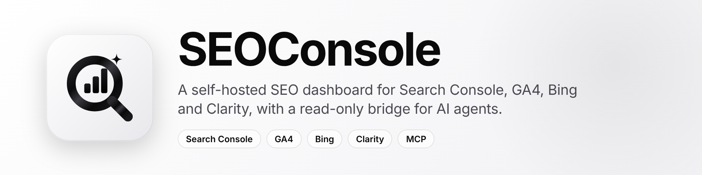

<h1 align="center"></h1>

> Formerly **OpenSiteConsole**. Only the name changed: the repository path, the default database file (`data/opensiteconsole.db`), the Docker service name and the `osc_` API-key prefix keep their old names on purpose, so existing installs, volumes and keys keep working. The on-page checker's user agent is now `SEOConsole/1.0`; if you had allowed the old one in a firewall rule, add the new one.

A self-hosted SEO dashboard for **all your Google Search Console properties across many Google accounts**.
It syncs your data into a local SQLite warehouse (so history is kept beyond Google's 16 months), joins it with GA4, Tag Manager,
Bing and Clarity, and turns it into a **ranked to-do list** (what to fix first and why), a weekly digest, calibrated SEO tests,
an indexing monitor, sitemap coverage and IndexNow submission. It also does the day-to-day Search Console chores (sitemaps,
URL inspection, property management) from one place, and exposes everything to AI agents over MCP: reading by default, and changes (submit URLs and sitemaps, mark a finding done, log a change, start a test...) only on keys and connections you explicitly allow, at one of three levels (read, submit, delete).

> **Status.** Everything is verified against demo data, unit tests and a headless-browser pass, but **nothing has been run against live Google data or on a real Cloudflare account**. Expect to debug first contact with the real APIs. Details are under *Known limits*.

## Quick start

```bash
pnpm install
cp .env.example .env        # then edit it
pnpm dev                    # http://localhost:5173
```

**Requirements:** Node.js 20.19+ or 22+, and pnpm 10 or 12 (`corepack enable` provides pnpm). Tested with Node 20.20, Node 22 and pnpm 10.28 / 12.16 on Linux. The SQLite driver is a native module: on Node 22 a prebuilt binary is used, while on Node 20 it is compiled during install (macOS needs the Xcode Command Line Tools: `xcode-select --install`).

pnpm 12 refuses packages published in the last ~day (`ERR_PNPM_MINIMUM_RELEASE_AGE_VIOLATION`). The committed lockfile already respects that; if you update dependencies and hit it, wait a day or run `pnpm clean --lockfile && pnpm install`.

**Run it on your own computer for the first Google sign-in.** The default redirect URI is `http://localhost:5173/auth/callback`, and "localhost" only reaches the app when it runs on the same machine as your browser. Put `GOOGLE_CLIENT_ID`, `GOOGLE_CLIENT_SECRET` and `ORIGIN=http://localhost:5173` in `.env`, then open `/accounts` and click *Connect Google account*. `.env` holds secrets: never commit or share it.

**Try it without Google credentials:** set `DEMO_MODE=1` in `.env`. Two synthetic accounts / six sites are created and
synced locally (with planted patterns: a decaying page group, cannibalising pages, an anomaly day).

**Connect real accounts:**
1. Google Cloud Console → enable the **Search Console API** → create an **OAuth client ID** (Web application).
2. Authorised redirect URI: `<ORIGIN>/auth/callback` (e.g. `http://localhost:5173/auth/callback`).
3. Put `GOOGLE_CLIENT_ID` / `GOOGLE_CLIENT_SECRET` in `.env`, restart, open **Accounts → Connect Google account**. Repeat per account.
4. While the OAuth consent screen is in *Testing*, Google expires refresh tokens after about 7 days — publish the app (or accept re-connecting weekly). Verify this against Google's current OAuth docs.

**Faster day-to-day use:** `pnpm serve` builds and starts the production server on `http://localhost:5173` (pages load in tens of
milliseconds instead of the hundreds `pnpm dev` takes, because dev compiles on demand). It reads `.env`, and defaults `ORIGIN`/`PORT`/`HOST`
for you. Do not run `node build` directly on localhost: without `ORIGIN` in the process environment, SvelteKit assumes https and rejects
every form submit as cross-site. `pnpm get-latest` pulls the latest `main` and installs packages (not `pnpm update`, which is pnpm's own command for upgrading dependencies).

## Deploying

**Set `ADMIN_PASSWORD`** before exposing the app beyond localhost: without it the app refuses non-loopback requests. Put it behind HTTPS. It is the **owner's** password; invite everyone else from the **Team** page (see *Team and roles* below).

| Where | How | Status |
|---|---|---|
| **Your computer / a server** | `pnpm serve` (or `pnpm start` after `pnpm build`) | The tested route. |
| **Coolify / a Docker server behind a proxy** (recommended for always-on use) | [`compose.coolify.yaml`](compose.coolify.yaml) and [`deploy/coolify/`](deploy/coolify/README.md): the app plus a named volume for the database, healthcheck, proxy-header settings, backup and data-move steps. Works the same on Railway (volume at `/data`). | The compose file parses and the healthcheck and proxy-header settings were tested against a running server; the image was **never built** and nothing was deployed. |
| **Docker (plain)** | `Dockerfile` and `compose.yaml` (data in a volume) | Written, **never built**. |
| **Cloudflare** | [`deploy/cloudflare/`](deploy/cloudflare/README.md): a Worker in front of a Cloudflare Container running the app, the database replicated to an R2 bucket with Litestream, and a cron trigger that wakes it. Needs the Workers Paid plan and Docker on the computer you deploy from. | Written from the documentation. The Worker type-checks, `wrangler deploy --dry-run` accepts it and the start script is tested against a stand-in, but the image was **never built and nothing was deployed**. |
| **Hosted plan (control app)** | [`cloud/`](cloud/README.md): a separate small program that sells a **$9/month hosted instance**: sign-up, Stripe Checkout, and automatic creation of one private instance per customer through the Coolify API, with grace period, suspension and retention rules. The app itself stays free to self-host. | Built and tested against fakes (45 tests); **never run against real Stripe, Coolify or Google review**. Needs your Stripe, Coolify and domain details, and Google OAuth verification before public use. |
| **Native Cloudflare Workers + D1** | Not supported. [`spike/workers/REPORT.md`](spike/workers/REPORT.md) sizes the port (374 functions and 818 calls become async; D1's 10 GB cap) and includes a working proof. | A feasibility spike: staged go, not a quick change. |

**Public pages.** `/privacy` and `/terms` are readable without signing in, even when `ADMIN_PASSWORD` is set, because Google's OAuth verification needs a public privacy policy. They show nothing about the installation. Fill in `LEGAL_ENTITY` and `LEGAL_CONTACT_EMAIL` first. The Digest page is no longer in the top menu (it is still at `/digest`, and the weekly digest still runs).

**Dashboard on its own subdomain (for example `app.example.com`, with a website on the main domain).** The address the app is served at appears in four places, and all four must move together: your reverse proxy / Coolify domain, the `ORIGIN` environment variable, the Google OAuth client's *Authorized redirect URI* (`https://app.example.com/auth/callback`, plus `/auth/bing/callback` if you use Bing sign-in), and the connector URL you gave Claude (`https://app.example.com/api/mcp`). After changing them, remove and re-add the Claude connector (it was registered against the old address) and sign in again. Existing API keys keep working; only their address changes.

## Team and roles

**Unlimited users, free.** The owner (or an admin) invites people from the **Team** page; each gets a role, and editors and viewers can be limited to some sites.

| Role | Can |
|---|---|
| **Owner** | Everything. The owner is whoever signs in with `ADMIN_PASSWORD` (or `ADMIN_PASSWORD_HASH`); it is not a row in the database, so it can never be disabled, demoted or locked out. Without a password, the app answers only this machine, and that machine is the owner. |
| **Admin** | Everything, including the team (invite, revoke, change roles and sites, disable, remove), API keys and app sign-ins on the MCP page, connections (Google accounts, Bing, GA4, Tag Manager, Clarity, OpenSEO, CrUX), adding or removing Search Console properties, site settings and the Clarity install through Tag Manager. Always sees every site. |
| **Editor** | Uses the app: sync, mark actions, notes, SEO tests, indexing checks, URL and sitemap submissions, IndexNow, the request list, digests, Google updates. Cannot connect or disconnect accounts, manage API keys, change site settings or manage the team. |
| **Viewer** | Sees every page; every request that changes something is refused. |

- **Invites.** An invite is a link: **there is no email sending in SEOConsole**, so you copy the link (shown once) and send it yourself. It works once, expires after 7 days, and only a SHA-256 of it is stored. The person opens it, chooses a name and a password (at least 10 characters) and is signed in. A new invite for the same address replaces the old link; pending invites can be revoked. Invite links have their own per-visitor attempt limit (10 bad links per 15 minutes). Invites need `ADMIN_PASSWORD` to be set.
- **Signing in.** Team members sign in with email and password. The owner can leave the email empty and use the admin password as before (the owner password is accepted whatever the email field holds). A wrong email, a wrong password and a disabled account all get the same answer, and an unknown email costs the same password check as a real one. The existing per-visitor attempt limit covers both.
- **Sessions** record who is signed in. A role or site change applies on the next request; disabling or removing someone signs them out everywhere; changing their password, or the owner password, ends their sessions.
- **Enforced on the server, for every request.** One table (`src/lib/server/roles.ts`) gives each form action and endpoint the role it needs, and `src/hooks.server.ts` applies it before any action runs; anything not in the table needs admin. A test reads every route file and fails if an action is missing from the table. Buttons are not hidden to enforce anything (a viewer sees a note that changes will be refused).
- **Limited to some sites.** Such a person sees only those sites: other sites' pages answer "Unknown site", the Dashboard lists only theirs, and pages that cover every site (Actions, Portfolio, Sitemaps, Digest, Accounts, Connect, MCP) are closed to them. A deleted site leaves every scope, as it does for API keys.
- **Audit log.** Invites created, accepted and revoked, role and site changes, members disabled, enabled and removed, each with who did it; admins see them on the Team page.
- **Demo mode** shows example people and a pending invite on the Team page; invites and changes are disabled there.
- `READ_ONLY=1` still applies to everyone, the owner included.

## Environment variables

All are optional except where noted; copy `.env.example` to `.env`. On Cloudflare they are Worker secrets or variables instead.

| Variable | Meaning |
|---|---|
| `GOOGLE_CLIENT_ID`, `GOOGLE_CLIENT_SECRET` | Google OAuth client (not needed in demo mode). |
| `ORIGIN` | Public address of the app; builds the OAuth redirect URI. |
| `APP_SECRET` | 32+ random characters; encrypts OAuth tokens at rest. If unset, a key is generated next to the database. **Required on Cloudflare**, where the disk is wiped. |
| `ADMIN_PASSWORD` | The owner's password (the owner can do everything; team members are invited from the Team page and have their own). Required before any non-local access, and before anyone can be invited. Changing it signs everyone out, team members included. |
| `ADMIN_PASSWORD_HASH` | Instead of `ADMIN_PASSWORD`: a scrypt hash (`pnpm hash-password`), so the password itself is never stored. Wins if both are set. |
| `OAUTH_REDIRECT_URI` | Hosted plan only: the one shared Google redirect address (the control app's `/oauth/callback`). Leave empty for a normal install. |
| `DEMO_MODE=1` | Synthetic data, no Google credentials. |
| `DB_PATH` | SQLite file (default `./data/opensiteconsole.db`). |
| `GOOGLE_INCLUDE_GA4`, `GOOGLE_INCLUDE_GTM` | Ask for GA4 / read-only Tag Manager access in the same consent (default 1). |
| `BING_CLIENT_ID`, `BING_CLIENT_SECRET` | One-click Bing sign-in; otherwise paste a Bing API key. |
| `INDEX_MONITOR_URLS` | URLs the indexing monitor inspects per run (default 40, max 200). |
| `ONPAGE_ALLOW_PRIVATE=1` | Let on-page checks reach private addresses (only if your site lives on your own network). |
| `LINK_CRAWL_PAGES` | Pages the internal-link crawl fetches per site (default 60, max 500): the ones with the most impressions in the last 90 days. |
| `READ_ONLY=1` | Read-only Google scope and write actions disabled. |
| `MAX_ROWS_PER_DAY` | Per-day row cap in the warehouse (default 100,000). |
| `DIGEST_WEBHOOK_URL`, `DIGEST_WEBHOOK_FORMAT`, `DIGEST_DAY` | Weekly digest and urgent alerts: https webhook, `slack` (default) / `discord` / `json`, weekday 0-6 (default 1 = Monday). No email. |
| `MCP_OAUTH_REDIRECTS` | Extra callback addresses an MCP client may register for "Sign in" (comma-separated, exact, https only). Claude's own is built in. Leave empty unless you connect another client. |
| `MCP_INSPECT_PER_KEY_DAY` | Live URL inspections one API key may cause per day through `inspect_url` (default 100, max 2000; Google allows about 2,000 a day per property). |
| `INDEX_RECHECK_PER_RUN` | URLs the automatic day 1 / 3 / 5 re-checks inspect per site per run (default 40, max 200). They share Google's URL Inspection quota with the indexing monitor. |
| `REQUEST_INDEXING_PER_DAY` | Pages the Request tab lists per site per day, and the allowance it counts what you asked against (default 10, max 50). Google does not publish its limit; third-party sources say about 10 to 12 a day, which is unverified. |
| `COMPARE_HOSTED_PRICE` | The sentence about the hosted plan's price on the public `/compare` pages (default: "$9 a month, $29 with the advanced indexing features, launch price $19"). Say what is true for your hosting. |
| `LEGAL_ENTITY`, `LEGAL_CONTACT_EMAIL`, `LEGAL_GOVERNING_LAW`, `LEGAL_UPDATED` | Who the public privacy policy (`/privacy`) and terms (`/terms`) speak for. Until the first two are set the pages say "the operator of this SEOConsole installation" and signed-in users see a reminder. The texts are a starting point, not legal advice: have them reviewed before relying on them (for example for Google's OAuth verification). |
| `MCP_SUBMIT_PER_KEY_DAY` | URLs one API key with the submit permission may push to search engines per day, UTC (default 200, max 10,000). |
| `GOOGLE_INCLUDE_INDEXING=1` | Ask for Google's Indexing API permission on new Google connections and allow that channel. Google documents the API for **job-posting and livestream pages only**: every other page is refused. `INDEXING_API_MAX_PER_DAY` caps notifications per site per day (default 200, the quota as I understand it; verify it). |
| `GOOGLE_INCLUDE_SITE_VERIFICATION=1` | Ask for the Site Verification permission, so a site can be proven and added from the Accounts page or over MCP. |
| `INDEXNOW_ENDPOINT`, `INDEXNOW_MAX_PER_DAY` | IndexNow endpoint (https) and URLs per site per day (default 1000). |

## Getting credentials

**Google (Search Console + GA4 + Tag Manager)** — one OAuth client serves all three, and OpenSEO can share it.
1. [Google Cloud Console](https://console.cloud.google.com/) → create/select a project → enable **Google Search Console API**, **Google Analytics Admin API**, **Google Analytics Data API** and **Tag Manager API**.
2. OAuth consent screen → *External* → add your Google accounts as test users, then **Publish app** (in *Testing*, Google expires refresh tokens after about 7 days — verify against Google's current docs).
3. Credentials → *Create OAuth client ID* → *Web application* → add redirect URI `<ORIGIN>/auth/callback`.
4. Put the client ID/secret in `.env`. To reuse OpenSEO's client, add this redirect URI to that same client instead.
5. Tag Manager access is requested read-only (`tagmanager.readonly`) in the same consent; set `GOOGLE_INCLUDE_GTM=0` to leave it out. Accounts connected before this was added must use *Connect Google account* again to grant it. Whether Google requires app verification for this scope on a published app: I have not checked, so verify in the consent-screen settings.

**Bing Webmaster Tools** (per Microsoft's docs) — two options:
- *API key (simplest, no registration):* sign in at bing.com/webmasters, verify your sites, **Settings → API Access → API Key → Generate API Key**. One key per Bing user, covering all their verified sites. Paste it on the **Connect** page.
- *OAuth (one-click for your users):* in the same **API Access** section choose **OAuth Client**, register a name and the redirect URI `<ORIGIN>/auth/bing/callback`, then set `BING_CLIENT_ID` / `BING_CLIENT_SECRET`. Scope used: `webmaster.read`.

**Microsoft Clarity** — per project: open the project → **Settings → Data Export → Generate new API token** (project admins only). Paste it on the **Connect** page for that site. Limits (Microsoft docs): 10 API calls per project per day, data for the last 1–3 days only, 1,000 rows, no paging — so SEOConsole stores one snapshot a day.

## Connecting sources (the "Connect" page)

One page, seven independent steps, status per site. Google sign-in grants Search Console, GA4 and Tag Manager together; Bing needs a key (or OAuth);
GA4 properties are auto-matched to sites by their web-stream URL; Tag Manager containers by their domain (or a container name that is the site's address), across every connected account that has Tag Manager access; Clarity needs a token per site; OpenSEO needs its URL + an `oseo_` API key; Core Web Vitals needs one free Google API key (enable the *Chrome UX Report API* in Google Cloud, then Credentials → API key).
Sites are matched by domain; anything unmatched is listed and can be linked by hand. In demo mode, type `demo` as any key/token.

## OpenSEO and AI agents

- **Sign in from a connector (claude.ai, Claude Desktop, ChatGPT-style clients that use OAuth):** no key to paste. In Claude: *Customize → Connectors → Add custom connector*, URL `https://<your-address>/api/mcp`, Authentication **Sign in now**, and if it asks how Claude identifies itself choose **Register automatically**. Click Connect: your browser opens SEOConsole's approval page, you sign in (as the owner or an admin: approving creates an API key), choose all sites or some, and Allow. The app gets a read-only token that renews itself (access token 1 hour, refresh token 60 days unused) and shows up on the Agents page with a "sign-in" tag; **Revoke** cuts it off. This is a small OAuth 2.1 server built into the app (dynamic client registration, PKCE S256, rotating refresh tokens; the discovery documents are at `/.well-known/oauth-protected-resource` and `/.well-known/oauth-authorization-server`). Only Claude's callback (`https://claude.ai/api/mcp/auth_callback`) and local loopback addresses may register by default; allow another client's exact https callback with `MCP_OAUTH_REDIRECTS`. It was tested against a simulated client and a real browser, **not yet against the real claude.ai**. The public address must be https and reachable from the internet.
- **Agents page** → create an API key (optionally limited to some sites) → add SEOConsole as an MCP server next to OpenSEO's. For Claude Code, run the command shown there in a terminal **on your own computer** (not in a cloud session), then check it with `claude mcp list`. By default it is available only in the folder you ran it in; add `--scope user` right after `mcp add` to use it in every project (per Claude Code's documentation, user-scope servers live in `~/.claude.json`, which the desktop app's Code tab also reads). The key is a bearer token that is shown once: keep it private and delete it on the Agents page if it leaks. Sixty-one tools: forty-one only read (every connected source: Search Console, GA4, Tag Manager, Bing, Clarity, Core Web Vitals, OpenSEO link, and every analysis below: trends, content groups, SEO tests, indexing, on-page, internal-link suggestions, AI traffic, the action queue, the weekly digest, sitemap coverage, IndexNow and Google updates, almost all answered from stored data) and twenty change things (see the three levels below). Each change tool refuses unless that key or sign-in has the level it needs, and is refused when `READ_ONLY=1`. The ones that change things in the app itself (`mark_action`, `log_change`, `start_seo_test`, `set_brand_terms`, `sync_site`, `read_sitemaps`, `run_onpage_check`, `submit_indexnow`, `watch_urls`) act on URLs of that site only, are limited to 30 a minute per key, and are written to the audit log with the key's name; the Agents page shows that log. Nothing can delete your data, connect or disconnect accounts, create keys, or touch credentials: those stay in the app. Three tools reach Google live: `get_sitemaps` (Google's own sitemap status), `inspect_url` (URL Inspection for up to 5 URLs of the property; answers are reused for 12 hours, `refresh` spends URL Inspection quota) and the sync itself. `get_page_insights` returns the same combined per-page view as the Pages tab (below). `get_performance` answers questions like "mobile in the US last month against the month before": one dimension (query, page, country, device or date), any date range, an optional comparison window (a change is only claimed when the stored history covers it), and country, device and text filters. The **Agents** page has copy-paste setup for Claude Code, Claude (custom connector with a header credential), Codex and generic clients; ChatGPT's connectors are reported to expect OAuth, which this server does not implement, so it may not work there (unverified). `get_connections` tells an agent which sources are connected, and `get_tracking_health` cross-checks Search Console, GA4 and Tag Manager.
- **Three levels of key, read-only by default.** *Read only* sees everything and changes nothing. *Submit* (Agents page, or the level chosen when signing in a connector) can also use the nine tools that change things inside the app (listed above) and send URLs and sitemaps to search engines and set things up: `submit_urls_for_indexing`, `submit_sitemap`, `inspect_and_submit_urls`, `run_indexing_check`, `setup_indexnow`, `build_request_indexing_queue`, `mark_indexing_requested`, `get_site_verification_token` and `verify_site_ownership`. *Submit and delete* adds the two things that cannot be undone by calling the tool again, `delete_sitemap` and `cancel_indexing_queue`, and those take **two calls**: the first changes nothing and returns what would go plus a single-use `confirmation_token` (10 minutes, this key, this site, this target); only a second call that presents it does the work. That stops one mistaken or injected call from deleting anything and puts a pause where a person can look; it does not prove a person agreed, because an agent with a delete key can make both calls, which is why that level is separate and never the default. Submitting is limited per key per day, respects `READ_ONLY=1` (which grants only read keys), is written to the audit log, and a site-limited key cannot use the account-level tools. `cancel_indexing_queue` (throws away the queued URLs) is the other delete tool. `submit_urls_for_indexing` takes `drip_days` and `queue_overflow`. `inspect_and_submit_urls` inspects up to 20 URLs and then submits the ones that are not indexed and not blocked, in one call; the Request list tools build and record that list (the button itself cannot be pressed through any API). Read-only tools include `get_submission_status` (with the day 5 verdict and the queue), `get_indexing_quotas`, `get_request_indexing_queue`, `get_sitemap_lastmod_health`, `get_quick_wins`, `get_internal_link_suggestions`, `suggest_indexing_candidates` and `check_sitemap`. The tool definitions every client loads at the start of a session are kept under about 33 KB (a test enforces it), down from 38 KB; shortening further would mean loading tools on demand, which is not built.
- Connect OpenSEO on the Connect page and each site is linked to its OpenSEO project by domain. An agent calls `get_openseo_project` to obtain the project id, then uses OpenSEO's own tools (keyword research, rank tracking, audits) on it — first-party history from here, third-party data from there.

## Using the dashboard

- **Privacy eye** (header): blurs site names, accounts, avatars, page and sitemap URLs, and branded queries (those containing your brand terms) for screenshots and screen sharing; hover tooltips that would reveal them are suppressed. The choice is remembered per browser. Numbers and non-branded queries stay visible. Your browser's own status bar can still show a link's address on hover.
- **Eye on a card:** hides that site from the dashboard (it leaves the totals and stops syncing). A toast offers Undo, and "Show hidden sites" at the bottom brings it back.
- **Light theme only**: there is no theme switcher, and the app ignores your OS dark-mode setting.
- **Hover explainers:** on the Actions page, hover any chip (type, ≈ clicks / 28d, confidence, effort, "Do first: blocking") or button (Open, Done, Snooze 30d) for what it means. Done hides an item for 90 days and Snooze for 30 days; either returns if the problem is still found.
- **Short pages:** each page opens with one sentence about it and folds the rest of the explanation under "How this works"; Actions cards show what to do first, with the reasoning and evidence folded. A test fails if a page gets a paragraph over 45 words that is not folded (the privacy, terms and comparison pages are meant to be read and are left out).
- **A site report opens on a two-week plan:** Overview starts with *Your next two weeks*: blocking problems first, then up to four quick wins and three bigger opportunities, picked from the ranked findings, each with its first step, its click estimate and a Done button. The traffic chart, unusual days and the change log follow.
- **MCP page with a setup guide:** the menu item is *MCP* (also at `/mcp`). It shows this server's MCP address (`ORIGIN` + `/api/mcp`, for example `https://app.seoconsole.app/api/mcp`) with a copy button, and step-by-step tabs for Claude, ChatGPT, Claude Code, Codex and other apps. Claude signs in with no key. ChatGPT signs in once its callback address is in `MCP_OAUTH_REDIRECTS`, and the page says whether it is.
- **Charts where they answer faster than a table:** the traffic chart as small multiples (each measure on its own real axis), where searches rank (with 12 weeks of history, and each bucket opening the matching searches), brand vs non-brand clicks, an opportunity scatter and your click-curve chart, before/after dumbbells, a decay map (pages × weeks), each competing page's position over time for cannibalization, index status and reasons, and device and country splits. Chart colours come from a palette checked for colour-blind readers.
- **Advanced filters on Queries:** a position range, plus regex include and exclude (like Search Console's custom filter), behind an *Advanced filter* toggle. Opening a search shows its full history and which of your pages rank for it.
- **A short tab row:** eight tabs are always on show (Overview, Quick wins, Actions, Opportunities, Queries, Pages, Indexing, Tests); the other 18 sit under *More*, grouped (Traffic, Findings, Indexing, Other sources, Site) with a line on what each is for. Every table header explains itself on hover (for example Est. +clicks, vs site, CTR).
- **Tab titles and tab hints:** every page sets its own browser-tab title (for example "Queries · SEOConsole"; it never contains a site name, because privacy mode cannot blur the tab strip or your history), and every tab on a site's page explains itself on hover.
- **Dashed end of each chart:** the last two days, which Google may still revise.

## What it does

| Area | Details |
|---|---|
| **Warehouse** | Incremental sync (re-pulls the newest 3 days, which Google revises) + resumable backfill to the retention horizon. Stores `date × query × page × country × device`, plus accurate daily totals. Background scheduler; per-site status. |
| **Dashboard** | Every property from every account: KPIs, sparklines, period-over-period deltas, search, tags, hide. |
| **Site analysis** | Change chart with anomaly bands; queries & pages (branded split, country/device filters, full-history chart per row, CSV export); segments. |
| **Search types** | Web, Image, Video, News, Discover and Google News reported separately (Overview and the dashboard are Web only, as in Search Console), plus the *search appearance* report (rich results and similar), which Google only provides on its own. |
| **Pages (all sources side by side)** | One table with a band per source, joined on the page's URL path (www, http and https variants count as one page), each metric with its change against the previous period (▲/▼ %): **Google** (clicks, impressions, CTR, position), **Bing** (clicks, impressions, position), **GA4** (sessions that landed there from Google organic search, engaged share, key events) and **Clarity** (sessions, sessions with rage clicks and with dead clicks). A dash means that source has nothing for the page. Changes are only shown where that source's previous period is stored: Google's history must reach back over it, Bing's stored range must too, and GA4's previous window is pulled with the daily sync (not for the 16-month view, which would predate what GA4 keeps). **Clarity covers only its latest 24-hour snapshot**, not the selected period, and its per-URL field names are from memory of its documentation and the demo data (a row that does not match contributes nothing), so verify on first contact. GA4 sessions and Google clicks are different measurements and are not expected to match. Users in GA4 are unique users over the window, as GA4 reports them, not a sum of daily users. The same data is available to agents as `get_page_insights`. |
| **Tag Manager** | Read-only. Stores each linked container's *published* version (tags, triggers, variables) and a per-site **Tag Manager** tab with a tracking audit that combines all three sources: unpublished container, container sending to a different GA4 property than the one linked (compares `G-` measurement IDs), no GA4 tag, paused / trigger-less / leftover Universal Analytics tags, and GA4 organic sessions far below Search Console clicks (a heuristic: sessions and clicks are different measurements, so it is a prompt to look, not proof). The one write: **installing Microsoft Clarity** (Clarity tab), only after the owner grants separate edit/publish access (`tagmanager.edit.containers`, `tagmanager.edit.containerversions`, `tagmanager.publish`, asked for on its own and never with `READ_ONLY=1`), shows a preview, and confirms. The tag goes into a new workspace; SEOConsole publishes only when the container's newest version is the live one, otherwise it leaves the workspace for you to publish. The API calls for this are written from my knowledge of Tag Manager API v2 and were not run against a live account: check the first install in Tag Manager. |
| **Clarity script check** | Daily, and after a Tag Manager or Clarity sync, SEOConsole fetches the home page and the two biggest pages and looks for Clarity's snippet (also inside a Next.js payload) and for Tag Manager containers, then combines that with the linked container's tags and the latest Clarity snapshot: *connected but the script is missing* (a warning in the action queue), *a Clarity tag in Tag Manager that never fires*, *recording although the script is not in the HTML* (added by JavaScript: no alarm), *installed but not connected*, and *two Clarity projects on one page*. The Clarity tab shows it as three checks (script, token, data) with both ways to install: one click through Tag Manager, or the code for the site's `<head>`. A script that only the page's own JavaScript adds is invisible to the HTML check, which is why recorded sessions override it. |
| **Trends** | *Winners & losers* (queries and pages that moved by more than noise, same Poisson test as Decay), *new & lost queries*, *position bands* (non-branded queries in 1–3 / 4–10 / 11–20 / 21–50 / 51+), *question-style queries* (English heuristic; also a filter on Queries), *trajectories* (weekly direction of the biggest queries) and a *projection*: level plus a damped robust trend for 8 weeks with a range, and last year's same weeks for reference. The projection does **not** model seasonality or Google updates; it says what happens if recent behaviour continues, not what will happen. |
| **Groups** | Pages grouped by URL folder (any depth), queries clustered by shared words (transparent word match, not semantic), a month-by-month **decay heatmap** (complete months only), locale folders such as `/en-gb/` with where their clicks come from (flags a region folder earning most clicks from another country), and cannibalization *within a country*. |
| **Tests** | Before/after, **split** (control pages, picked by hand or matched on traffic level) and **redirect / URL switch** tests (old and new URLs measured together, so moved traffic is not a loss). Lift of test pages relative to control pages with a 95% interval, p-value and verdict. Traffic drifts on its own, so the noise level is **measured on the site's own earlier windows** (the same comparison run at dates when nothing changed); a test needs at least four windows of history before the change (112 days for 28-day windows, 56 for 14-day ones). With less it shows an *estimate with no verdict*. The control is, by default, **matched automatically**: pages in the sections of the site whose weekly clicks moved with the test pages before the change (chosen from pre-change data only, so it cannot be influenced by the result). Simulation of sites whose sections drift together: a real +50% change was detected 23-53% of the time against the rest of the site and 90-95% with the matched control, with 0-1.4% false verdicts on unchanged pages. Results are stored and refreshed after each sync, so the tab opens instantly. Observational, not randomised: it shows "unlikely to be noise given the control", not proof of cause. Also needs 7+ days after the change, enough clicks before it, and a fully downloaded "before". **Judged on conversions too** when GA4 is linked: Google-organic sessions and key events for the same test and control pages, with the same calibration; key events are rare, so many tests honestly say "not enough to judge" (a test scoped to a different host than the property cannot be separated in GA4, which has no hostname on landing pages, and says so). A change-log entry with a URL prefix can be turned into a test with one click, and its verdict shows on the entry. Google's ranking updates inside a test window are listed next to the result. |
| **LLM tests** | Any test (before/after, split or redirect) can be **measured on AI-assistant sessions instead of search clicks**: GA4 sessions that arrived from ChatGPT, Perplexity, Gemini, Claude and Copilot, all of them or one, for changes such as rewriting pages for AI answers or adding FAQs and schema. Choose *AI-assistant sessions* under *Measure on* (or pass `metric: "ai_sessions"` and optionally `assistant` to the `start_seo_test` MCP tool). Once such a test exists, the GA4 sync loads AI-assistant sessions **by day, assistant and landing page** for the range the test needs (back far enough for the noise calibration; nothing is loaded for a site without an LLM test). The statistics are the same as for clicks: lift against control pages, a 95% range, a p-value and the noise level measured on the site's own earlier windows. AI traffic is usually small, so the result says **"too little AI traffic to tell"**, with the smallest change the test could have seen, when the test pages had fewer than 30 AI sessions before the change, the control fewer than 100, or the test could only have seen a change bigger than ±50%; that is not shown as "no effect". An automatically matched control is chosen on search clicks; if it had fewer than 100 AI sessions before the change, every other page is used instead and the test says so. The result shows AI sessions a day for the test pages against the control (scaled to the test pages' level before the change) with the change date, the verdict, and the test pages' sessions a day by assistant before and after; search clicks on the same pages are shown alongside for context. **The limit:** GA4 only sees assistants that send a referrer; visits from assistants (or apps) that send none land in Direct and are not counted, so an LLM test measures referred AI visits, not all of them. Assistant names in GA4 referrers are from my knowledge and change; not verified against a live property. Demo data plants a page whose AI sessions rise about 2.4x 42 days ago (`/blog/<topic>-9`) and one that does not change (`/products/<topic>-4`); the form says which. |
| **Indexing** | Opt-in per site: re-inspects the biggest pages daily (up to `INDEX_MONITOR_URLS`, default 40, least recently checked first) and logs *de-indexed, newly indexed, canonical changed, blocked by robots.txt, page fetch error*. First check is a baseline; changes appear from the second. URLs are checked in priority order: your **watch list**, pages that **appeared for the first time** this period (their indexing is still open), pages that lost visibility, then the biggest pages. Shows Google's reasons for non-indexing, the indexed share over time, and why a run stopped: a quota stop resumes tomorrow, a refusal (403) retries in ~6 h and a total failure in ~2 h, instead of being marked done or hammered. Plus **weak and dead URLs**: every page Search Console has shown, classed dead / not indexed / fading / underperforming / weak (cut-offs are heuristics). |
| **On-page** | Fetches a page of the site and checks title, meta description and H1 against the queries the page already earns clicks for (exact / all words / some words / missing), plus noindex, canonical, missing or several H1s. Fetching is confined to the site's own host or its subdomains (standard ports only, never an IP address, re-checked on every redirect) and refuses private addresses at connect time, so a name that resolves to localhost or a cloud metadata address is not fetched; 10 s timeout, 1.5 MB cap; JavaScript is not run. Set `ONPAGE_ALLOW_PRIVATE=1` only if the site genuinely lives on your own network. |
| **Internal links (Findings, under More)** | Answers "which of my pages should link to page X, and with which words?" for pages close to ranking better. Free, no credits. **Crawl:** up to `LINK_CRAWL_PAGES` (default 60) of the pages Search Console showed in the last 90 days, most impressions first, four at a time, through the same hardened fetcher as the on-page check (this site's host only, private addresses refused at connect time, 10 s timeout, 1.5 MB cap); weekly, or with *Crawl now*. Per page it stores the final URL, title, H1, the main text (the `<main>` element if there is one, otherwise the body without nav, header, footer, asides, forms and scripts; headings left out because a link belongs in a sentence) and every same-site link with its anchor text (resolved, fragment dropped, `<base href>` honoured; menu links flagged). **Targets:** pages with searches at positions 4-20 and real impressions (brand searches left out), ordered by the extra clicks reaching position 3 would bring on the site's own CTR curve (the Opportunities estimate). **Suggestions:** for each target's top five searches, the other crawled pages whose text has the search as a phrase (whole words, any case, a plural folded, spaces or hyphens between the words) or, failing that, all its main words within a few words of each other in one sentence (only for searches with three or more main words, or a reordering of all of them), and that do not link to the target in any way (menus included; a page that redirects to the target counts as the target; a phrase that is already a link is not offered again). Score = the search's prize x match (exact 1, loose 0.6) x the linking page's own traffic (1 + log10(1 + clicks) + 0.5 log10(1 + impressions/100)); one row per linking page and target (its best search), five per target. Each row has the anchor text as the page writes it, the sentence it is in, copy buttons and a **Done** mark (stored; it hides the row and comes back with Undo; the next crawl drops it for good once the link is there). Also lists **pages nothing links to**: pages with impressions that none of the crawled pages links to (the home page left out). The three best targets go into the action queue (`links:<page>`, low confidence, since a link is one push and not a guarantee of the prize), and MCP has `get_internal_link_suggestions` (from the stored crawl; it never crawls). |
| **AI-assistant traffic** | On the GA4 tab: sessions from ChatGPT, Perplexity, Gemini, Claude and Copilot by landing page, found by the referrer GA4 recorded. A floor, not a total: assistants that send no referrer land in Direct. |
| **Core Web Vitals** | LCP, INP, CLS (plus FCP, TTFB) from the Chrome UX Report for phone and desktop, rated good / needs improvement / poor; one snapshot a day, so history builds from when you connect. Site-wide field data, not per page. |
| **Opportunities** | Striking distance ranked by *estimated extra clicks* using a **CTR curve fitted to your own data**; pages whose CTR is far below your curve. Below that, **hidden opportunities** that need more than one source or period: searches that stopped earning clicks, fast-rising searches you have not won, pages sitting just below the top for several searches, question searches you rank low for, searches where Bing ranks you top five and Google does not, pages Bing shows nothing for, pages that convert better than average but rank 4-20 (GA4), landing pages where visitors leave or never convert (GA4), rage and dead clicks (Clarity), and searches that rank worse on phones. Each also appears in the action queue and in the MCP tool `get_opportunities`; one that needs a source you have not connected says so instead of staying silent. |
| **Cannibalization** | Merges URL variants first (www / slash / tracking params), then flags queries split across real competing pages, with clicks at stake. |
| **Decay** | Significance-tested (Poisson z) drops, labelled *page-specific* vs *site-wide*, with year-over-year when history allows. |
| **Anomalies** | Day-of-week-aware robust detector (not fooled by weekends). |
| **Action queue** | Every finding the app can make as **one ranked list** (per site and across sites; also an MCP tool): measurement broken, key pages blocked or de-indexed, traffic collapse, dead pages, cannibalization, CTR gaps, decay, striking distance, the hidden opportunities listed under Opportunities, on-page and sitemap problems, finished tests. Blocking items come first, then estimated clicks per 28 days × confidence (high 1, medium 0.6, low 0.3), then items with no honest estimate. Estimates come from the site's own CTR curve and history, are model figures rather than promises, and are **not added together** because findings overlap. *Done* hides an item for 90 days and *snooze* for 30; if the problem is still detected afterwards it returns. The key for blocked / de-indexed / not-indexed items depends on the set of pages, so a changed set reappears as a new item. |
| **Digest and alerts** | A weekly digest (headline, top actions, real movers, Google updates, decided tests) made once a week on `DIGEST_DAY` (catching up if the server was off), and **urgent alerts** for blocking problems, checked every ~3 h, announced once and again only if still open after 14 days. Both are stored on the **Digest** page. Delivery is a **webhook only** (`DIGEST_WEBHOOK_URL`, Slack / Discord / generic JSON); **there is no email delivery**. A failed weekly delivery is retried at most hourly; urgent alerts mention at most 8 items per message and the rest follow in the next one. Teams Workflows webhooks are untested. |
| **Sitemap coverage** | Reads the sitemaps you submitted (follows indexes, gzip, up to 25 files / 200,000 URLs, only URLs of the property) and compares them with the pages Search Console has shown in 90 days: **never shown** (no impression at all; pages under two weeks old counted separately) and **earning clicks but missing from every sitemap**. "Never shown" uses the stored query×page detail, which leaves out anonymised and very rare queries, so treat it as a list to inspect, not proof of non-indexing. A **Check** button explains a "pending" sitemap (Google's own `isPending` flag: it accepted the file and has not processed it yet; resubmitting does not speed it up). The indexing monitor looks at never-shown pages first. |
| **Google updates** | Ranking-update dates from Google's Search Status Dashboard feed (plus your own entries), shown on the traffic chart, in tests that overlap one, in the action queue and in the digest. |
| **IndexNow** | Per site: creates the key, serves `/{key}.txt`, verifies it on each host, and submits new, changed and removed URLs (from the sitemap diff and the indexing monitor) to `api.indexnow.org`, with a 24 h per-URL cooldown and a daily cap (`INDEXNOW_MAX_PER_DAY`). **Google does not take part in IndexNow** (Bing, Yandex, Naver, Seznam and others do); the tab shows your Bing share of clicks against Google's so you can judge the value. For Google, the sitemap is still the route. |
| **Submit (Indexing tab)** | One panel (and the MCP tools above) that pushes URLs to every channel that takes them and says what each did: **IndexNow** (Bing, Yandex, Naver, Seznam, Yep; not Google), **Bing's URL submission API** (needs Bing linked; stays within the quota Bing reports) and **Google's Indexing API** (job-posting and livestream pages only; the page's own structured data is checked first and anything else is refused). Google has no "request indexing" call for ordinary pages that a tool can use, so for those it submits and resubmits sitemaps and then tracks what happened: submitted URLs go on the indexing monitor's watch list and the table shows, per URL, each channel's answer and Google's latest inspection (and whether it was taken after the submission). Presets: new pages, never-shown pages, removed pages. Dry run shows the plan without sending. **Queue and drip:** what does not fit a channel's daily limit is queued and sent on the following days (every 15 minutes the scheduler releases what is due; the app must be running), and "spread over N days" (1-30) sends an even share a day; the queue holds up to 5,000 URLs and drops anything still unsent 7 days after it was due. **Automatic re-checks:** every accepted URL is asked about again with Google (URL Inspection) at day 1, 3 and 5; an indexed URL is finished and comes off the watch list, and one that is still not indexed at day 5 is flagged "still not indexed" with Google's coverage text. **Limits panel:** IndexNow use against its cap, Bing's allowance as last read, the Indexing API cap, URL Inspection use today against the roughly 2,000 a day per property Google allows (as I understand it), and the queue. The status table downloads as CSV. |
| **Quick wins (Findings tab)** | The low-hanging fruit, from Search Console data the app already holds, grouped by what you would do and always low effort: top-10 pages whose click rate is far below your own curve (rewrite title and description), searches at positions 8 to 15 (one push from page 1), question-shaped searches you already rank for (add a direct answer), pages earning clicks that no sitemap lists, titles and descriptions the on-page checker flagged, and pages waiting on the Request list. Estimated extra clicks come from your own CTR curve and are not added up. Also `get_quick_wins` over MCP. |
| **Decay, year on year** | The Decay tab compares pages with the previous period or with the same weekdays a year earlier (needs 12+ months of stored history), which catches the slow slide a month-on-month view misses. Over MCP: `get_opportunities` with `type: decay, compare: year_ago`. |
| **Comparison pages** | Public `/compare` and `/compare/<tool>` pages put SEOConsole next to SEOTesting.com, IndexChex, Promptwatch and Google Search Console, feature by feature, with screenshots of the app (demo data) and the price of each next to free self-hosting. They are meant to be fair: what a competitor offers comes from its own public pages with the date they were read, "not stated" is never turned into "no", and the rows where the competitor is ahead stay in (tests guard that). |
| **Request indexing (Indexing tab)** | Search Console's Request Indexing button is the one fast, official way to ask Google about a page, and it has **no API**, so this tab prepares the work and tracks the result. "Build today's list" takes candidates (pages changed or new in the sitemap, pages you pinned, pages never shown in search, URLs you sent that are still not indexed), asks Google about them (URL Inspection), drops what is already indexed and up to date, sets aside pages where asking is pointless (robots.txt or noindex, not fetchable, another canonical) under "Fix these first", and keeps as many as the daily allowance allows. Each row links to Search Console (the link Google returns for that URL, shown only if it really points at search.google.com), with Copy URL, "I requested it" and Skip. Recording a request logs it with the other submissions and gives it the same day 1, 3 and 5 re-checks; it stays off the list for 14 days (a skip, 30). |
| **Sitemap dates (Sitemaps tab)** | Checks whether the `<lastmod>` dates are worth Google's trust: invalid dates, dates in the future, one date on most URLs (a build stamp), nearly everything changed this week, URLs with no date; whether Google re-crawled the pages whose date moved (from the URL Inspections already stored: a sample); and, on request, a live comparison of a sample of pages' own `Last-Modified` headers with their sitemap dates. The thresholds are this app's own rules of thumb, not Google's. |
| **Change log** | Annotate changes; get a before/after readout **adjusted for the site's overall trend**. |
| **Search Console actions** | Sitemaps (list / submit / resubmit / remove, per site and bulk across all sites), URL Inspection (cached 12 h), add / remove property. |
| **Portfolio** | The per-site findings merged into one list across all your visible, synced sites (a property that another already covers counts once; hidden sites are left out): striking distance, cannibalization (most serious cases), content decay and anomalies. Each site is judged on its own data first. Hover a tab, or read the line under the tabs, for what each means. |
| **Security** | OAuth tokens encrypted at rest (AES-256-GCM); password login with a per-visitor attempt limit and server-side sessions (random ids, 14-day expiry, ended by logout or a password change); team members with roles (owner, admin, editor, viewer) and optional site limits, checked on the server for every form action and endpoint, with single-use, hash-only, 7-day invite links; without a password the app serves only a request that really comes from this machine (checks the connection's address and the `Host` header, and refuses anything behind a proxy), demo mode included; cross-site state-changing requests refused (including form posts with no Origin; only the server-to-server MCP and OAuth endpoints are exempt); "Sign in" for connectors uses PKCE S256, exact callback matching, one-time codes (5 minutes), tokens stored as hashes, refresh tokens that rotate and revoke the grant if an old one is replayed; Content-Security-Policy, HSTS over https, no-store on private pages; API keys stored as hashes, scoped per site, rate-limited, with a daily budget of live URL inspections; outbound fetches confined to the site's own host and refused for private addresses; containers run as an unprivileged user and the database file is owner-only; `READ_ONLY=1` mode; audit log; CSV formula-injection guard. See *Security notes* under Known limits. |

## Compared with SEOTesting.com: what is still missing

Read from its public pages on 2026-11-07 (see `/compare/seotesting` for the full table). SEOConsole already has before/after, split and redirect tests with a control group, significance, conversions and Google updates, plus decay, cannibalization, CTR gaps, AI-assistant traffic and question queries. It also has an internal-linking tool (the *Internal links* tab, no credits). LLM tests (before/after and split tests on AI-assistant sessions from GA4) are built too, see *LLM tests* above. More than one user is built: unlimited users with roles, free (see *Team and roles*). **Not built yet:** a monthly plain-English report (there is a weekly digest) and robots.txt change watching. Competitor comparisons for indexing and AI visibility are on `/compare/indexchex` and `/compare/promptwatch`; there too the things SEOConsole does not do (indexing third-party backlinks, prompt tracking, citations, AI crawler logs) are marked "No".

## Known limits (read these)

- **Anonymised queries**: Google hides some queries, so query tables never sum to the totals. The share is shown per site.
- **Per-day row cap** (`MAX_ROWS_PER_DAY`, default 100k): very large sites lose long-tail detail beyond it. Totals stay exact. Large sites may want Google's bulk BigQuery export instead.
- **Not yet built**: Yandex, email delivery of digests (webhook only) and of team invites (links are copied by hand), i18n, PDF/client reports, SERP/rank tracking, a REST API and monthly / white-label client reports (planned, not built), **writing** to Tag Manager / GA4 through MCP (creating tags, key events or custom dimensions, publishing containers); the only Tag Manager write is the opt-in Clarity install in the app, described above.
- **Verified**: unit/integration tests (`pnpm test`, 932 passing), type-check (`pnpm check`), production build, and a headless-browser crawl of the pages against **demo data**, including privacy-mode and phone-width checks.
  **Not verified against the live services (written from their documentation, run only against fakes and demo data)**: Bing's `SubmitUrlBatch` / `GetUrlSubmissionQuota` calls, Google's Indexing API, and Google's Site Verification API (token and verify calls; what each method's token looks like and how Google words its refusals may differ from what the app shows), and that URL Inspection returns `inspectionResultLink` for the URLs the Request tab asks about (it uses that link for "Open in Search Console"; without one the row links to Search Console's home page). Expect small fixes on first real use. **Not verified**: a live Google OAuth round-trip and real Search Console / GA4 / Tag Manager / Clarity / Chrome UX Report responses (search types, search appearance, GA4 landing pages and Core Web Vitals are tested against documented response shapes and demo data only), the Bing OAuth flow, and the OpenSEO connection against a real instance — no credentials were available. Bing's API-key endpoint and its error format *were* confirmed against the live service (a deliberately invalid key returned Bing's documented `InvalidApiKey`). The MCP server was checked with the official MCP SDK client. Expect to debug first contact with the real APIs.
- **Motion** is short and subtle (page settle, staggered cards, charts drawing left to right, small bars growing, press feedback), and is switched off entirely for people whose system asks for reduced motion.
- **Internal links** read HTML only: JavaScript is not run, so a site that builds its content in the browser (a single-page app without server rendering) reads as nearly empty and gets few or no suggestions, and links added by script are not seen. Only the crawled pages (default 60) are sources, so "nothing links to it" means none of those, not the whole site. Matching is word based (English stop words, a simple plural fold); it does not understand synonyms, and a mention in a sentence that is about something else can be suggested. The prize is the striking-distance estimate for the search, not what one link will earn. `nofollow` links still count as links.
- **Comparisons wait for history.** Trends, Groups, Indexing classes and SEO tests compare against the previous period; while that period is still downloading, or has no data, they say so instead of showing every query as a winner.
- New analysis tabs (Trends, Groups, Tests, Indexing, On-page) are verified against demo data, controlled synthetic data with planted effects, an independent code review, and unit tests. Simulation of the SEO-test statistic (400 trials per case, daily traffic with drifting levels, no real change): about 40-60% false verdicts with a plain Poisson error, 0-4.5% after calibrating on earlier windows. The price: on very drifty traffic a real +40% change is detected only 15-45% of the time (on steady traffic, over 99%), so "no clear effect" is not "no effect". Not verified against real Search Console history, real URL Inspection responses (field names such as `verdict`, `robotsTxtState` and `pageFetchState` are from my recollection of the API) or real GA4 referrer names for AI assistants, which change.
- Unconfirmed details coded defensively: Tag Manager API v2 field names (`domainName`, `usageContext`, tag `type` codes `googtag` / `gaawc` / `gaawe` / `ua`, `paused`, `firingTriggerId`, and the 404 for a never-published container), GA4 `webStreamData.measurementId`, and Tag Manager API quotas (check Google's current documentation); a container with no `domainName` and a name that is not an address cannot be auto-matched, so link it by hand. GA4 `rows[].dimensionValues/metricValues` field names and the web-stream `defaultUri` used for auto-matching (if absent, link GA4 by hand); Clarity metric field names beyond `Traffic` (shown generically).
- Search Console API quotas (including URL Inspection) change; check Google's current documentation.
- Action queue, digest, sitemap coverage, conversions in tests, Google updates and IndexNow are verified against demo data, unit tests (mutation-checked), a browser pass, a real-shaped sitemap fixture, Google's real incidents feed, and an independent code review. **Nothing has run against live Google data.** GA4 data-retention behaviour, `measurementId`, Tag Manager and URL Inspection field names, and Google's refusal of off-property URLs (403) come from recollection; verify on first contact. GA4 loads more than 600,000 landing-page rows for a period are refused (the conversion block shows an error) rather than truncated, and so are more than 300,000 AI-assistant rows for an LLM test.

### Security notes
- **What was tested.** Live attack probes against a running server (every route unauthenticated, path and `__data.json` tricks, cookie forgery and replay, cross-site posts, DNS-rebinding `Host` headers, a network client against a no-password instance, oversized and malformed MCP requests, scope leakage across 28 tools), an independent code audit, regression tests for each hole found (mutation-checked), and a browser pass for the CSP. Holes found and fixed this way: an open instance when bound to all interfaces, a session cookie that never expired and survived logout, DNS rebinding, a demo mode open to the network, a regular expression that froze the server on a hostile page, gaps in the private-address check, and quota abuse through `inspect_url`. **This is not a guarantee that no loophole remains**, and it was not a professional penetration test.
- **Run it behind HTTPS and set `ADMIN_PASSWORD`** for anything beyond your own computer. If a reverse proxy sits in front, make sure it passes the real visitor address (or accept that the login attempt limit is shared by everyone behind it).
- **Prompt injection.** Search queries, page titles and URLs come from third parties and appear in MCP output and chat digests. The MCP server tells agents to treat them as data, and chat messages escape mentions and markup, but a model can still be misled by text it reads; keep API keys read-only (the default) and scoped to the sites an agent needs, and turn changes on only for connections you trust. Of the 61 MCP tools, 41 only read (apart from `inspect_url`, which spends URL Inspection quota); the other 20 need an explicit allow per key and can only do the reversible or local things listed above, but a misled agent with changes allowed could still, for example, mark real findings done or send your URLs to IndexNow, so the audit log on the Agents page is worth a look.
- **Known remaining limits.** `APP_SECRET` is hashed with plain SHA-256 (use 32+ random characters; it is not stretched). `list_sites` shows the Google account label to any key that can see the site. Error text from Google is passed through. A self-hosted OpenSEO may sit on a private address, so only credentials in the URL and link-local / cloud-metadata addresses are refused when connecting it. The Cloudflare Worker passes the visitor address in a header the container trusts (untested on a real account). Dependency audit: 4 low-severity advisories in a build-tool chain.

## Layout

```
src/lib/*.ts             pure, unit-tested logic: analytics, tracking, trends, groups, experiments (SEO test statistics),
                         indexing, onpage, actions (queue ranking), digest, sitemap (parser), indexnow
src/lib/server/          db, crypto, Google/Bing/Clarity clients, sync engine, job queue and scheduler, SQL queries, MCP server,
                         and the DB-backed halves of the features: actions, digest, seotests, ga4tests, llmtests, sitemapcov,
                         indexmon, indexnow, gupdates; demo data source
src/lib/components/      shared Svelte components (charts, action cards, ...)
src/routes/              dashboard, portfolio, actions, digest, updates, accounts, sites/[id]/* tabs, auth, /api/mcp
static/                  favicon, touch and app icons, the web manifest, and static/brand/ (the logo files below)
tests/                   vitest (and real-shaped fixtures in tests/fixtures)
deploy/cloudflare/       Worker, entrypoint and Litestream config for the Cloudflare Container deploy
cloud/                   hosted-plan control app (sign-up, Stripe, Coolify provisioning, OAuth relay); its own build and tests
spike/workers/           feasibility spike and proof for a native Workers + D1 port (not part of the app)
Dockerfile, compose.yaml, Dockerfile.cloudflare, wrangler.jsonc   container and Cloudflare deploy files
```

## Website

`site/` is the marketing page for seoconsole.app: static HTML, CSS and a little vanilla JavaScript, no build step, no third-party requests, light mode only. It has its own `Dockerfile` (nginx, port 8080) and strict security headers. See [`site/README.md`](site/README.md) for previewing, deploying and refreshing the screenshots. `tests/site.test.ts` keeps it honest: links resolve, nothing loads from another origin, the tool count matches the MCP server, and no customers or ratings are claimed.

## Brand

The logo is a magnifier holding three rising bars, in graphite chrome on a white tile (a dark twin exists). Files in `static/brand/`:

| File | Use |
|---|---|
| `logo-light.svg`, `logo-dark.svg` | The full icon with its tile, for sizes of about 64 px and up: README, docs, slides, social images, the login page. |
| `mark-light.svg`, `mark-dark.svg` | The simplified icon (lens and bars only, thicker), for 16 to 48 px: the favicon and tiny tiles. The sparkle disappears at those sizes, so it is left out. |
| `mark-glyph.svg` | The glyph with no tile, for the app header on a light page. |
| `banner.png` | The README banner (rendered with the Inter font). |

The browser-tab icons, the Apple touch icon and the home-screen icons in `static/` (`favicon.svg`, `favicon.ico`, `favicon-32.png`, `apple-touch-icon.png`, `icon-192.png`, `icon-512.png`, `icon-512-maskable.png`) were rendered from these SVGs; the Apple and maskable ones are full-bleed squares because iOS and Android round the corners themselves. A test checks that every file exists, is the right size and is referenced. **The logo has not been checked against existing logos or trademarks.**

## License

SEOConsole is free software under the **GNU Affero General Public License v3.0** (AGPL-3.0-only). See [LICENSE](LICENSE).
In short: you may use, study, modify and share it. If you modify it and let other people use your version over a network
(for example as a hosted service), the AGPL requires you to offer those users the corresponding source code. This summary is
not legal advice; the license text is what applies.
